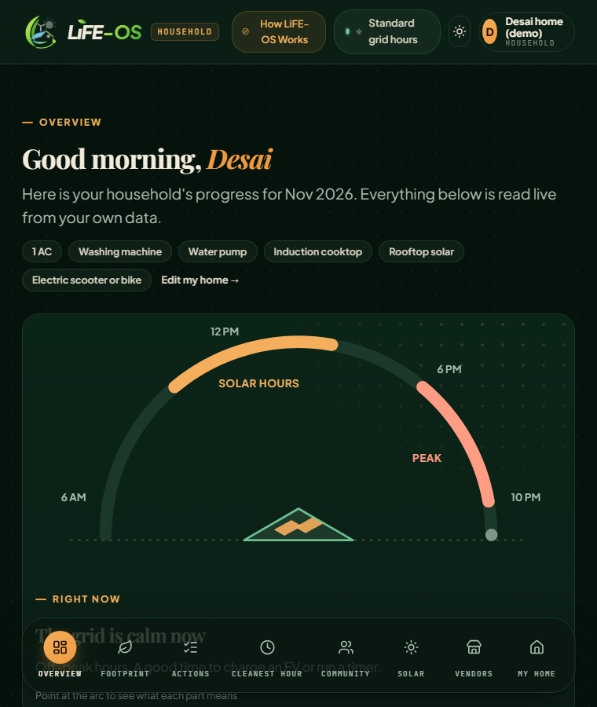
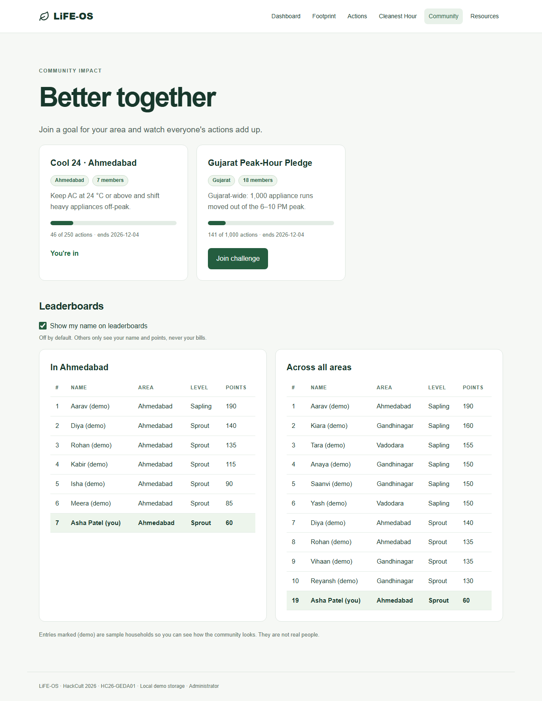
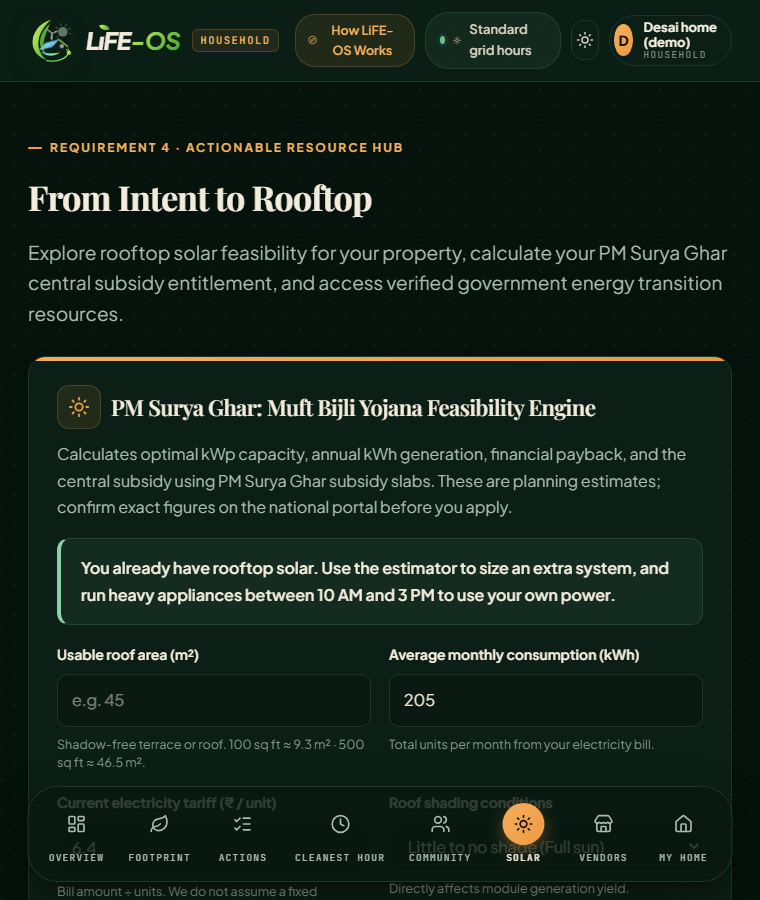
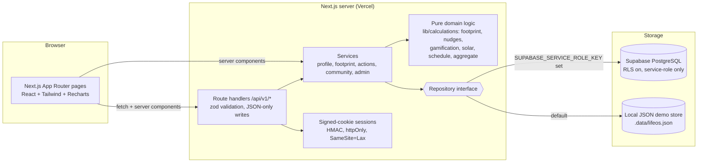
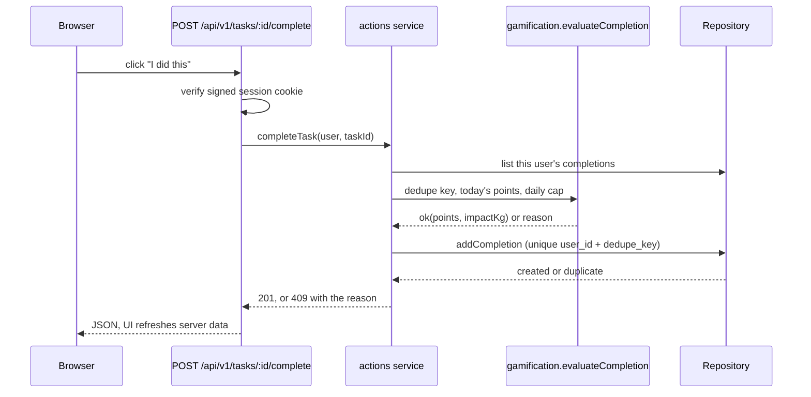
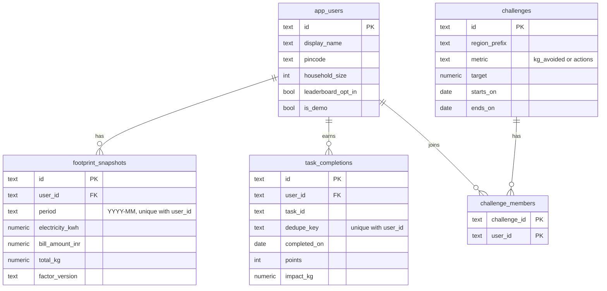

# LiFE-OS

**A zero-friction sustainability companion for Mission LiFE.** LiFE-OS turns a household's electricity bill into a carbon footprint, rupee-relevant saving suggestions, a rooftop solar estimate and shared community goals, with area-level views for GEDA administrators that never expose a single household.

Built for **HackCult '26**, problem statement **HC26-GEDA01: Development of an Interactive "Mission LiFE" Citizen Engagement Application** (Gujarat Energy Development Agency).

> **Honest status.** Every feature below is implemented and runs end to end with persistent data. A few inputs are *planning assumptions* rather than audited figures (emission factors, solar subsidy, the Cleanest Hour intensity curve). They are stored in one place each, shown to the user beside every result, and listed under [Limitations](#limitations).

## What it does

| Brief requirement | What you get | Where |
| --- | --- | --- |
| **Personalised footprint tracker** | One-minute onboarding from last month's units, a baseline, monthly history and trend, travel and LPG add-ons, and a visible calculation | `/onboarding`, `/footprint`, `/dashboard` |
| **Behavioural nudges and micro-tasks** | Rule-based suggestions from the user's own bills and the time of day (evening-peak alert, usage rise, AC season), plus 10 daily, weekly and one-time tasks | `/actions` |
| **Gamification and social impact** | Points, streaks, levels, local and Gujarat-wide challenges with shared targets, opt-in leaderboards | `/community` |
| **Actionable resource hub** | Rooftop solar estimator with ranges, assumptions and today's local sunshine; step-by-step path to apply; links to official bodies; a vendor directory with admin review and a verify-before-you-pay checklist | `/resources`, `/vendors` |
| **State administrators** | Server-protected area view with small-group suppression, plus review of vendor listing requests | `/admin` |
| **Extra: Cleanest Hour** | Move appliances across a 24-hour clock and compare modelled emissions | `/schedule` |
| **Extra: live weather** | Today's forecast (Open-Meteo, no key) drives the AC and drying nudges and the solar insight | `/dashboard`, `/actions`, `/resources` |
| **Extra: accounts** | Optional email and password so a household can sign in from any device, or start anonymously | `/login`, `/onboarding` |
| **Extra: bill-based savings bonus** | Units that fall 5% or more against last month earn bonus points, measured from the bills | `/footprint` |
| **Extra: installable** | Web app manifest and service worker, so it installs on a phone like an app | all pages |

### Screens

| Dashboard | Community | Resource hub |
| --- | --- | --- |
|  |  |  |

Pitch deck: [`docs/LiFE-OS-pitch-deck.pdf`](docs/LiFE-OS-pitch-deck.pdf) · Demo script and submission checklist: [`docs/SUBMISSION.md`](docs/SUBMISSION.md)

### What makes it different

- **Rupees, not just kilograms.** Savings in ₹ use the household's *own* bill amount and units. We never guess a tariff.
- **Explainable by design.** Each nudge states why it fired and how the saving was estimated. Each task lists its assumption.
- **Fair by construction.** One reward per task per day, week or lifetime, enforced by a database unique key, plus a daily points ceiling.
- **Privacy first.** Leaderboards are opt-in. Admins see only areas with at least 5 households, grouped by the first 3 PIN digits.
- **Distinctive civic aesthetics.** Rejects generic AI templates in favour of an editorial, warm design system (*Vedic Solar & Heritage Botanical*).

### Design Identity — *Vedic Solar & Heritage Botanical*

* **Typography Pairing:**
  * **Headings:** Playfair Display — distinguished editorial serif conveying civic dignity and climate journalism elegance.
  * **Body & Inputs:** Plus Jakarta Sans — ultra-legible modern humanist sans for tables, cards, and forms.
  * **Metrics & Units:** JetBrains Mono — crisp tabular alignment for kWh, kg CO₂e, and ₹.
* **Color Palette:**
  * **Heritage Pine (#0B2519):** Authoritative forest emerald symbolizing nature and conservation.
  * **Surya Amber (#D97724):** Warm terracotta gold honoring Indian solar energy and PM Surya Ghar.
  * **Alabaster Linen (#FBF8F3):** Warm paper-like canvas with a subtle organic dot grid texture.

### Two-Person Team Roles

* **Person 1 (Backend, Database, Calculations & Security):**
  * Core domain calculation modules in src/lib/calculations/ (grid-factor CO₂ footprint, solar feasibility, weather, gamification idempotency, bill-based savings, circadian schedule, and k-anonymity).
  * Next.js Route Handlers (src/app/api/v1/**), Zod validation, and CSRF protection.
  * Dual-mode persistence: in-memory/JSON local demo repository (.data/lifeos.json) and Supabase PostgreSQL with RLS.
  * HMAC-SHA256 signed cookie sessions and security boundaries.
* **Person 2 (Frontend Architecture, UI/UX, Interactions & Integration):**
  * All user-facing pages, responsive shells, and navigation with live IST grid phase pill.
  * Citizen onboarding with real-time carbon baseline computation preview.
  * Interactive footprint forms, month-over-month trend cards, and Recharts area visualizations.
  * Task completion buttons with optimistic feedback, streak meters, and points ledger.
  * 24-hour Cleanest Hour interactive circadian load-shifter.
  * PM Surya Ghar rooftop solar feasibility estimator with subsidy and payback modeling.
  * Community challenges and podium honor roll leaderboard.

## Architecture



**Layers**

1. **Pages** (`src/app`) are server components that read through services, with small client components for forms and buttons.
2. **Route handlers** (`src/app/api/v1`) validate every write with zod, require `application/json` (a CSRF guard on top of SameSite cookies), and return `{ data }` or `{ error }`.
3. **Services** (`src/services`) hold use-case logic and authorisation (who may do what).
4. **Domain** (`src/lib/calculations`) is pure, dependency-free TypeScript covered by unit tests.
5. **Repository** (`src/lib/store`) is the only persistence boundary. A Supabase PostgreSQL adapter and a local JSON store implement the same interface, so the app runs with zero setup and switches to Postgres by setting two environment variables.

### Completing a task (the fairness-critical path)



The client never sends points. A second simultaneous request is rejected by the unique constraint, not just by the check above it.

## Database schema

Defined in [`supabase/migrations/20261103000000_init.sql`](supabase/migrations/20261103000000_init.sql).



Row level security is enabled on every table with **no** public policy. The browser's publishable key can read and write nothing; only the server, holding the service-role key, touches data, and authorisation is enforced in the service layer.

## How the numbers are calculated

| Output | Formula | Source and caveat |
| --- | --- | --- |
| Footprint | `kWh × grid factor + km × vehicle factor + cylinders × LPG factor` | Factors in [`emission-factors.ts`](src/lib/calculations/emission-factors.ts), versioned and stored on every snapshot. The grid factor (0.71 kg/kWh) matches CEA's published national average for FY 2024-25. Newer CEA releases list a lower FY 2025-26 value (about 0.675), so refresh it before official use. |
| Rupee savings | `kWh saved × (bill amount ÷ units)` | The household's own rate. Omitted when no bill amount was entered. |
| Solar size | `min(roof area × usable fraction ÷ 10 m² per kWp, annual use ÷ yield)` | Shade lowers the usable fraction. Yield 1300–1600 kWh/kWp/yr gives a low–high range. |
| Solar payback | `net cost ÷ yearly saving`, low to high | Subsidy follows PM Surya Ghar as last known and is **flagged unverified** in the UI. |
| Solar today | `kWp × forecast radiation (kWh/m²) × 0.75` | Radiation from Open-Meteo at city level; 0.75 is a performance ratio. A planning estimate. |
| Bill savings bonus | `(last month's kWh − this month's kWh) ÷ last month's kWh`, 5% to 50% | 30, 50 or 70 points by size of the drop, once per month. Units are entered by the household, so this is bill-based, not audited. |
| Cleanest Hour | `kWh × factor × hourly intensity index` | The index is an **illustrative model**, not live grid data. |
| Area totals | Latest snapshot per household, grouped by 3-digit PIN prefix | Groups under 5 households are suppressed. |

## Tech stack

Next.js 15 (App Router) · React 19 · TypeScript (strict) · Tailwind CSS 4 · Recharts · zod · Supabase (PostgreSQL) · Vitest.

## Run it locally

Requires Node.js 24 and npm 11.

```bash
git clone https://github.com/bharathvaj125/Life-os.git
cd Life-os
npm ci
cp .env.example .env.local     # on Windows PowerShell: Copy-Item .env.example .env.local
```

Edit `.env.local` and set at least:

```dotenv
SESSION_SECRET=any-long-random-string
ADMIN_ACCESS_CODE=choose-a-code-for-the-admin-view
```

```bash
npm run dev
```

Open <http://localhost:3000>. With no Supabase variables set, data lives in `.data/lifeos.json` and is pre-filled with 18 clearly labelled **demo households** so the leaderboard, challenges and admin view are not empty. Delete `.data/` to reset.

### Switch to Supabase

1. Create a Supabase project and run the files in [`supabase/migrations/`](supabase/migrations/) in order in the SQL editor (`init`, then `vendors`, then `accounts`).
2. Set `NEXT_PUBLIC_SUPABASE_URL` and `SUPABASE_SERVICE_ROLE_KEY` (server-only) in `.env.local` or the host's environment settings.
3. Restart. The footer now reads "Supabase storage". Sign in to `/admin` and press **Load demo households** if you want sample community data.

### Deploy to Render

Create a Web Service from the repository (Node, build `npm ci && npm run build`, start `npm run start`) and set `SESSION_SECRET`, `ADMIN_ACCESS_CODE`, `NEXT_PUBLIC_SUPABASE_URL` and `SUPABASE_SERVICE_ROLE_KEY`. Render runs one long-lived process, which suits the app. The free plan sleeps when idle and takes about a minute to wake.

Vercel also works with Supabase, but without Supabase variables its serverless functions each get their own temporary storage, so the JSON store cannot be shared there.

## Commands

| Command | Purpose |
| --- | --- |
| `npm run dev` | Development server |
| `npm run build` / `npm start` | Production build and server |
| `npm run typecheck` | `tsc --noEmit` |
| `npm run lint` | ESLint, zero warnings |
| `npm test` | Vitest unit tests for the domain logic |

## Project layout

```text
src/
  app/                  pages and /api/v1 route handlers
  components/           forms, charts, layout, ui primitives
  features/             task catalogue, official resource list
  lib/
    calculations/       pure domain logic (tested)
    store/              Repository interface, JSON store, Supabase adapter, seed
    auth/               signed-cookie sessions, admin check
  services/             use cases and authorisation
  types/                shared types
supabase/migrations/    PostgreSQL schema
tests/                  unit tests
```

## Scalability notes

- Domain logic is stateless and pure, so the app scales horizontally on serverless.
- Writes are idempotent at the database (`unique(user_id, dedupe_key)`, `unique(user_id, period)`).
- Indexes cover per-user history and region grouping.
- Today the admin view and leaderboard read full tables. At state scale these should become SQL views or materialised aggregates (`GROUP BY left(pincode,3) HAVING count(*) >= 5`) refreshed on a schedule, and leaderboards should use a ranked, paginated query.

## Limitations

- **Emission factors are indicative.** Update `EMISSION_FACTORS` from the current CEA release before any official use.
- **Solar subsidy and cost figures are assumptions**, labelled unverified in the app. Confirm on the PM Surya Ghar portal.
- **Cleanest Hour is modelled**, not live grid data, and shows rupee effects only when the user supplies a peak surcharge.
- **Tasks are self-reported.** Fairness comes from once-per-window rewards and a daily cap. The bill-based savings bonus is stronger, but the units are still typed in by the household, so it is not audited.
- **Accounts are email and password only.** Emails are not verified and there is no password reset, because the app does not send email. Households can also stay anonymous, tied to one browser. Sign-in attempts are rate limited in memory, which suits one server process.
- **Vendor listings are reviewed by an administrator, not audited.** Empanelment claims are self-declared and the page tells citizens to verify them on the official lists. Sample listings are labelled as samples.
- **Weather is a city-level forecast** for Gujarat PIN codes, not a measurement at the user's roof. The service is free and has no uptime guarantee, so pages work without it.
- **No bill OCR, satellite roof tracing, map view or AI assistant** is implemented.
- Demo households are sample data and are included in admin totals, flagged as demo.

## Roadmap

1. Supabase Auth (verified email or phone OTP, password reset) replacing the app's own accounts, with per-user RLS policies.
2. Bill upload with OCR and a mandatory review step before saving.
3. Roof outline on a map with PVGIS yield for the chosen location.
4. DISCOM tariff slabs and time-of-day rules from official GERC orders, with an effective-date audit trail.
5. Hourly grid intensity from a published series to replace the illustrative Cleanest Hour curve.
6. Aggregate views as SQL materialised views, Gujarati and Hindi interfaces, and push reminder notifications.
7. A map view of vendors and community areas, and vendor listings imported from the official empanelment lists.

## Licence and credits

Created for HackCult '26. Mission LiFE is an initiative of the Government of India; LiFE-OS is an independent hackathon project and is not an official GEDA product.
